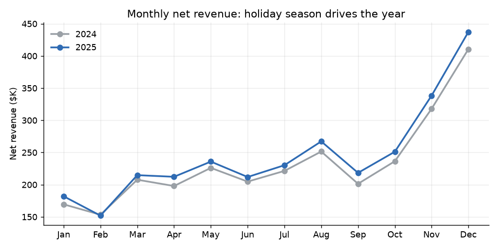
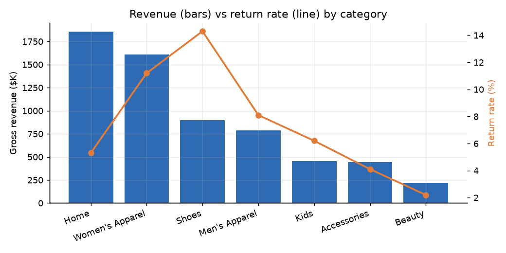
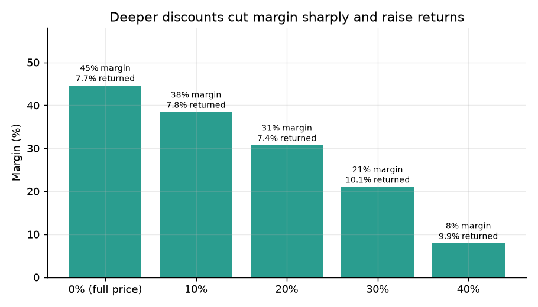
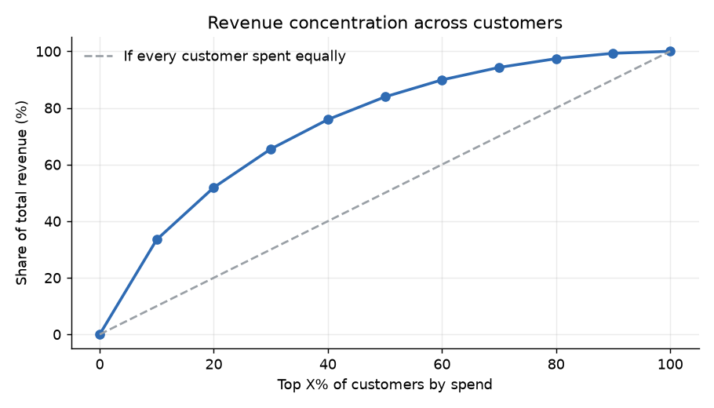
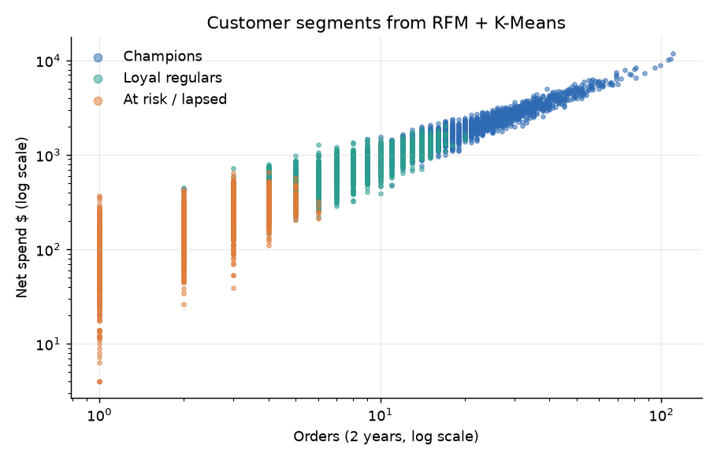

# Retail Sales & Customer Analytics

SQL and Python analysis of two years of sales (2024–2025) across six Denver-area retail stores: 62K orders, 212K line items, 6K customers. The project answers business questions about revenue trends, store performance, returns, discounting, and customer value, and it segments customers with RFM analysis and K-Means clustering.

> **Data note:** The dataset is simulated with `generate_data.py`. It is built to behave like real retail data (holiday peaks, loyalty effects, category-specific returns), but it is not data from any real company.

## Key findings

| Question | Finding |
|---|---|
| Is the business growing? | Net revenue rose **5.5%**, from $2.80M (2024) to $2.95M (2025). November and December alone brought in **26%** of 2025 revenue. |
| Where are returns hurting? | Shoes (14.3%) and Women's Apparel (11.2%) have the highest return rates. **"Wrong size"** causes 47–59% of apparel and shoe returns, so better size guidance is the clearest fix. Home returns are driven by defects instead. |
| Are deep discounts worth it? | Margin falls from **45% at full price to 8% at 40% off**, and items bought at 30%+ off are returned more often (about 10% vs 7.7%). |
| Are loyalty members worth more? | Members are 39% of buyers but bring in **55%** of revenue. They order about twice as often (15.8 vs 8.3 orders); their average order value is the same. The value comes from visit frequency, not bigger baskets. |
| How concentrated is revenue? | The top 10% of customers bring in **34%** of revenue, and the top 20% bring in 52%. |
| Which stores perform best? | Denver–Colfax leads in both total revenue and revenue per sq ft ($25.74). Littleton is #3 in revenue but last in revenue per sq ft, which suggests its large floor space is underused. |
| When should stores staff up? | Saturday (116 orders/day) and Sunday (104) are about 70% busier than Tuesday (67). |

### Customer segments (RFM + K-Means)

| Segment | Customers | Avg days since last order | Avg orders | Avg spend | Share of revenue |
|---|---|---|---|---|---|
| Champions | 1,864 | 14 | 22.5 | $2,097 | 68.0% |
| Loyal regulars | 2,300 | 63 | 7.5 | $691 | 27.6% |
| At risk / lapsed | 1,364 | 260 | 2.2 | $184 | 4.4% |

The silhouette score picked 3 clusters (0.38, compared with 0.32–0.34 for 4–6). The "at risk" group hasn't ordered in about 8.5 months on average, so it is the natural target for a win-back campaign.

## Charts







## SQL skills shown (`sql/analysis.sql`)

- **Schema design:** 6 tables with primary/foreign keys, CHECK constraints, indexes, and a reusable view (`v_sales`) (`sql/schema.sql`)
- **Joins** across fact and dimension tables, including a LEFT JOIN to flag returns
- **CTEs** for multi-step logic
- **Window functions:** `LAG` (year-over-year growth), `RANK`, `ROW_NUMBER` (top reason per category), `NTILE` (customer deciles), running totals with `SUM() OVER`
- **Conditional aggregation** with `CASE WHEN`, plus date functions for month, weekday, and recency

## How to run

```bash
pip install -r requirements.txt
python generate_data.py   # builds data/retail.db
python analysis.py        # runs the SQL, writes outputs/*.csv and charts/*.png
```

You can also open `data/retail.db` in DB Browser for SQLite or the VS Code SQLite extension and run the queries in `sql/analysis.sql` directly.

## Project structure

```
generate_data.py        simulated dataset -> SQLite
sql/schema.sql          tables, keys, indexes, v_sales view
sql/analysis.sql        9 business questions in SQL
analysis.py             runs queries, charts, RFM + K-Means segmentation
outputs/                query results as CSV
charts/                 PNG charts
```

## Tools

SQL (SQLite), Python (pandas, NumPy, scikit-learn, matplotlib)
